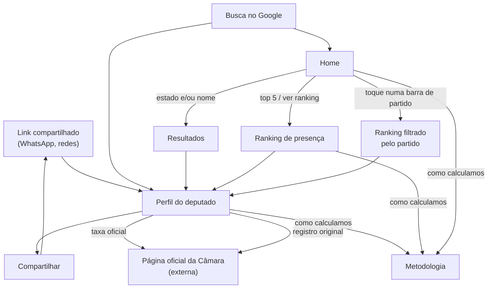

# Fluxo do usuário — Marco 1

> Escopo: Marco 1 (contexto §4.1) — presença dos deputados da 57ª legislatura, perfil e metodologia. Decidido em 2026-10-20.
> Cada tela cita as regras (RN), requisitos (RF/RNF) e decisões (DA) que a governam. Detalhe visual e de componentes fica para a spec de cada feature e para `docs/06-design/diretrizes-ui.md`.

## Como o eleitor chega e por onde anda

**Caminho principal (a pergunta do Norte):** Home → escolhe o estado (e/ou digita o nome) → Resultados → Perfil. No máximo 3 toques do início até a taxa do deputado.

**Entrada por link compartilhado:** cai direto no Perfil, que precisa ser compreensível sozinho — sem depender de ter passado pela Home.

## Telas

### Home

| Bloco | Conteúdo | Regras |
|---|---|---|
| Pergunta + busca | "Seu deputado comparece às sessões?" · seletor de **estado (UF)** · campo de **nome** · seletor de **casa** (no M1: Câmara selecionada; Senado aparece como "em breve", desabilitado) | DA05, DA06 |
| Deputados por partido | **Barras horizontais, cor única**, uma por partido, ordenadas por tamanho, com o número ao lado. Composição atual da Câmara (deputados em exercício). Toque na barra → ranking filtrado pelo partido | DA04, RN01 |
| Partidos com mais falta | **Barras horizontais, cor única**, com a **taxa agregada da bancada** (RN10), da menor para a maior presença, com o percentual visível. Partidos com menos de 5 deputados ficam fora, com nota | RN10, DA04 |
| Top 5 | Os **5 com menor presença** (mesma ordem do ranking), cada um com "X de Y sessões", e atalho "ver ranking completo" | RN04, RN08 |
| Rodapé | Fonte (Câmara dos Deputados), **data da última atualização**, link para a metodologia | RF07, RF08 |

Os gráficos nunca usam cor de partido nem cor de status (vermelho/verde) para qualificar ninguém; o valor numérico está sempre escrito, não só desenhado (WCAG, RNF05).

### Resultados

Lista de deputados do estado escolhido e/ou que casam com o nome digitado: foto, nome, partido atual, UF e a taxa de presença com "X de Y sessões". Quem está abaixo do corte da RN08 aparece com "amostra pequena" no lugar da taxa.

- **Sem resultado:** mensagem com sugestão (conferir o nome; escolher o estado).
- Regras: RN01, RN04, RN08.

### Perfil do deputado

| Bloco | Conteúdo | Regras |
|---|---|---|
| Identificação | Foto, nome, **partido atual**, UF; aviso de **troca de partido** no período, com o histórico | RN01, RF05 |
| Mandato | Período(s) em exercício na 57ª legislatura; se é suplente ou titular | DA03 |
| Presença | **Taxa** em destaque + "X de Y sessões" · contagens separadas: presenças, ausências justificadas (com motivos), faltas · explicação curta de "sessão deliberativa" e "ausência justificada" na própria tela | RN03, RN04, RN05 |
| Amostra pequena | Abaixo do corte da RN08: a taxa aparece com aviso e o deputado não entra no ranking | RN08 |
| Taxa oficial | Link "ver a frequência na página oficial da Câmara" (no M1, só o link) | RN09 |
| Fonte | Link para o registro original, data da última atualização, link para a metodologia | RF07, RF08, RF06 |
| Compartilhar | Botão de compartilhar; a prévia mostra nome, taxa, "X de Y sessões", **data e fonte** | RF10 |

### Ranking de presença

- Abre **ordenado pela menor presença**; o eleitor pode inverter.
- Filtros: **partido** (atual) e **estado**.
- Cada linha: posição, foto, nome, partido, UF, taxa e "X de Y sessões".
- Só entram deputados acima do corte da RN08; uma nota diz quantos ficaram de fora e por quê.
- Link para a metodologia no topo; data da última atualização no rodapé.
- Regras: RN01, RN04, RN05, RN08; HU01.

### Metodologia

Uma seção por estatística exibida (no M1: presença do deputado e taxa do partido), com: a regra em linguagem simples, um exemplo numérico, as fontes (DA07), as exceções (sessões remotas e semipresenciais, ausência justificada por dia, sessões canceladas) e por que o número pode diferir da página oficial da Câmara (RN09). Regras: RF06, princípio III da constituição.

## Elementos presentes em todas as telas

- Fonte e data da última atualização (RF07, RF08).
- Termos técnicos com explicação curta acessível por toque — Popover ou texto expansível, nunca Tooltip (diretrizes de UI).
- Funciona de 360 px a 1440 px sem rolagem horizontal (RNF09); alvos de toque ≥ 44 px no celular (D2).

## Fora do Marco 1

Propostas (HU02), tramitação e votos (HU03), Senado, 56ª legislatura, número oficial da Câmara lido diariamente (RN09 completa), métricas de alinhamento (DA04).
