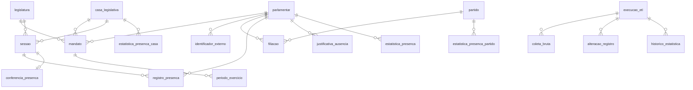

# Modelagem de dados — Marco 1

> Escopo: presença na Câmara (M1). Fonte única do schema: `schema.prisma` (ADR-0001); este documento descreve o porquê e as invariantes. Toda mudança de schema atualiza este arquivo no mesmo PR.
> Convenções: nomes do domínio em português, `snake_case` no banco (`@@map` no Prisma); datas e horas em `timestamptz`; a "data" de uma sessão é a data em `America/Sao_Paulo`.

## Visão geral

## Tabelas

### Referência

| Tabela | Colunas principais | Observações |
|---|---|---|
| `casa_legislativa` | `id`, `sigla` (`CD`, `SF`), `nome` | Carga fixa (seed). |
| `legislatura` | `numero` (PK: 56, 57, 58), `inicio`, `fim` | R03, RNF10. |
| `partido` | `id`, `sigla`, `nome` | Identificado pelo id da Câmara em `identificador_externo`. |

### Pessoas e mandatos

| Tabela | Colunas principais | Observações |
|---|---|---|
| `parlamentar` | `id`, `nome_parlamentar`, `nome_civil`, `url_foto` | **Não armazena CPF** (RNF06). |
| `identificador_externo` | `parlamentar_id`, `sistema` (`camara_v2`, `camara_carteira`, `senado`), `valor`, `legislatura_numero` (só para identificadores por legislatura) | Único por (`sistema`, `valor`, `legislatura_numero`). Base da reconciliação (ADR-0003 §2). |
| `mandato` | `id`, `parlamentar_id`, `casa_id`, `legislatura_numero`, `uf` | Único por (parlamentar, casa, legislatura). DA03. |
| `periodo_exercicio` | `id`, `mandato_id`, `inicio`, `fim` (nulo = em exercício), `condicao` (`titular`, `suplente`), `motivo_inicio`, `motivo_fim`, `fonte_url` | Derivado de `/deputados/{id}/historico`. Períodos de um mesmo mandato **não se sobrepõem**. |
| `filiacao` | `id`, `parlamentar_id`, `partido_id`, `inicio`, `fim` (nulo = atual), `fonte_url` | No máximo **uma filiação aberta** por parlamentar (RN01). |

### Sessões e presença

| Tabela | Colunas principais | Observações |
|---|---|---|
| `sessao` | `id`, `casa_id`, `legislatura_numero`, `id_externo` (evento v2), `data`, `inicio`, `ordem_no_dia`, `formato` (`presencial`, `semipresencial`, `virtual`, `desconhecido`), `situacao` (texto da fonte), `considerada` (bool), `descricao_fonte`, `fonte_url` | Só sessões **deliberativas** do plenário. `considerada` = deliberativa **e** encerrada (RN05). `ordem_no_dia` cruza com o legado (DA07). |
| `registro_presenca` | `sessao_id` + `parlamentar_id` (PK), `situacao` (`presente`, `ausente`), `fonte` (`camara_legado`, `camara_pagina_publica`), `coletado_em` | Um registro por parlamentar em exercício na sessão. |
| `justificativa_ausencia` | `parlamentar_id` + `data` (PK), `motivo`, `fonte`, `coletado_em` | **Por dia**, vale para todas as sessões do dia (RN03). |
| `conferencia_presenca` | `sessao_id` (PK), `presentes_fonte_principal`, `presentes_api_v2`, `divergente`, `conferido_em` | Conferência com a API v2; divergência gera alerta (S4). |

### Estatísticas (escritas só pelo cálculo do ETL)

| Tabela | Colunas principais | Observações |
|---|---|---|
| `estatistica_presenca` | `parlamentar_id`, `casa_id`, `periodo_tipo` (`legislatura`, `ano`), `periodo_valor` (ex.: 57 ou 2025), `sessoes_em_exercicio`, `presencas`, `ausencias_justificadas`, `faltas`, `sessoes_consideradas`, `taxa`, `elegivel_ranking`, `partido_atual_id`, `uf`, `versao_metodologia`, `calculado_em` | Única por (parlamentar, casa, período). `ano` = ano civil, como a página oficial da Câmara. Partido e UF ficam copiados aqui para os filtros (RN01). |
| `estatistica_presenca_casa` | `casa_id`, `periodo_tipo`, `periodo_valor`, `mediana`, `n_parlamentares`, `versao_metodologia`, `calculado_em` | RN11: mediana sobre quem tem `elegivel_ranking`. |
| `estatistica_presenca_partido` | `partido_id`, `casa_id`, `periodo_tipo`, `periodo_valor`, `presencas`, `sessoes_consideradas`, `taxa`, `n_membros`, `elegivel_comparacao`, `versao_metodologia`, `calculado_em` | RN10: taxa agregada da bancada atual; `elegivel_comparacao` = pelo menos 5 membros em exercício. |

### Operação e auditoria

| Tabela | Colunas principais | Observações |
|---|---|---|
| `execucao_etl` | `id`, `iniciada_em`, `terminada_em`, `status` (`sucesso`, `com_pendencias`, `falha`), `contagens` (jsonb), `erros` (jsonb), `versao_codigo` (commit) | RNF07. |
| `coleta_bruta` | `id`, `execucao_id`, `fonte`, `url`, `chave_r2`, `sha256`, `bytes`, `coletada_em` | Aponta para a resposta bruta no R2; só grava quando o hash muda (ADR-0003 §4). |
| `alteracao_registro` | `id`, `execucao_id`, `tabela`, `chave` (jsonb), `campo`, `valor_anterior`, `valor_novo`, `detectada_em` | Correções da fonte em registros já coletados. |
| `historico_estatistica` | `id`, `execucao_id`, `tabela`, `chave` (jsonb), `valor_anterior` (jsonb), `valor_novo` (jsonb), `motivo` (`novos_dados`, `correcao_fonte`, `nova_versao_metodologia`), `registrado_em` | Só quando o valor muda. |

## Invariantes garantidas pelo banco

O Prisma não expressa estas regras no `schema.prisma`; elas entram como SQL na migration (`prisma migrate dev --create-only` e edição do arquivo gerado), e cada uma tem teste de integração:

1. `estatistica_presenca`: `presencas + ausencias_justificadas + faltas = sessoes_em_exercicio` e `sessoes_consideradas = sessoes_em_exercicio − ausencias_justificadas` (RN04).
2. `estatistica_presenca.taxa` entre 0 e 1, nula só quando `sessoes_consideradas = 0`.
3. `periodo_exercicio`: `fim > inicio`, e sem sobreposição dentro do mesmo mandato (restrição de exclusão sobre o intervalo).
4. `filiacao`: no máximo uma linha com `fim` nulo por parlamentar (índice único parcial).
5. Papéis do Postgres: `etl_escrita` escreve; `site_leitura` só tem `SELECT` (ADR-0001, princípio V).

## Volume estimado (57ª legislatura)

| Tabela | Linhas |
|---|---|
| `parlamentar` / `mandato` | ~650 |
| `periodo_exercicio` | ~1.000 |
| `sessao` | ~600 (≈150 por ano) |
| `registro_presenca` | ~300 mil |
| `justificativa_ausencia` | ~20 mil |
| `estatistica_presenca` | ~3.300 (650 × legislatura + 4 anos) |
| `historico_estatistica` | ~100 mil por ano (taxas mudam a cada dia com sessão) |

Ordem de grandeza: dezenas de MB por legislatura, bem dentro do volume de 5 GB do Railway Hobby.

## Fora do Marco 1

`votacao`, `voto`, `orientacao`, `proposicao`, `autoria` — modeladas com HU02 e HU03.
